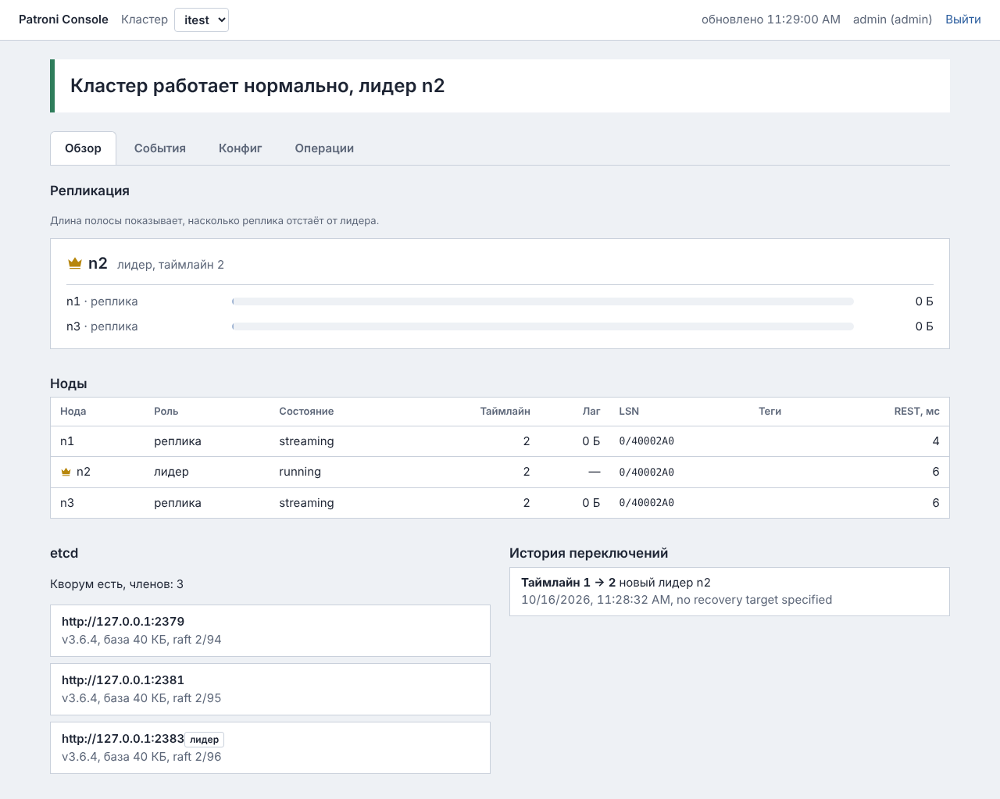
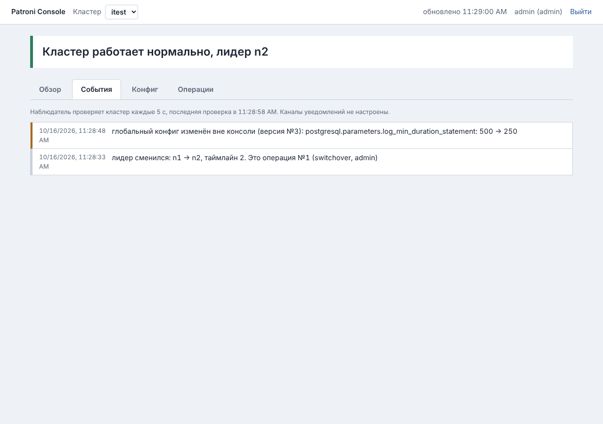
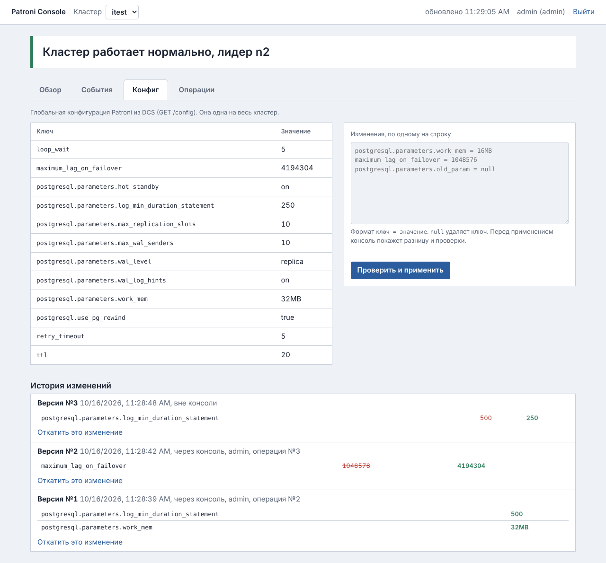
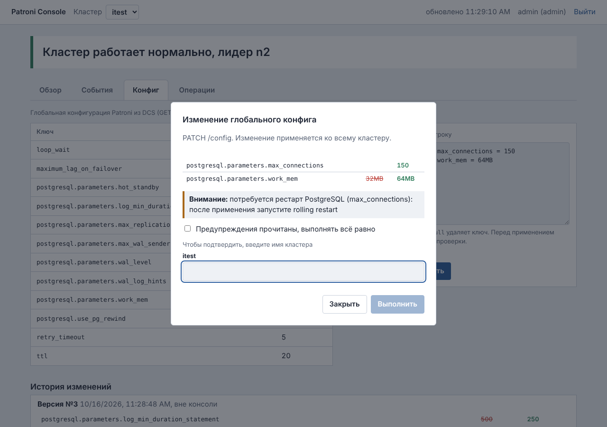
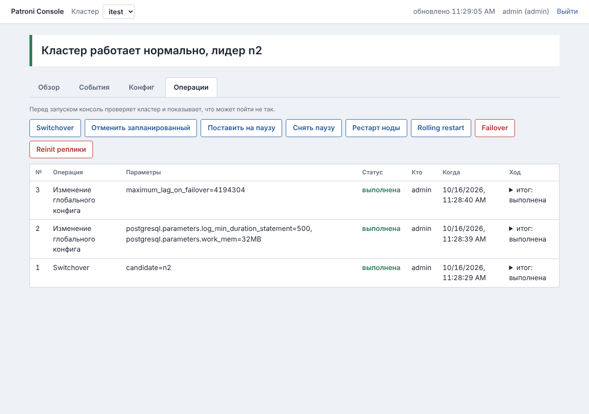

# Patroni Console

Веб-консоль для DBA, которые держат PostgreSQL в высокой доступности на **Patroni 4** и **etcd 3**.
Показывает состояние кластеров, безопасно выполняет переключения и рестарты, ведёт историю
глобального конфига и сообщает о проблемах в Telegram или webhook.



## Зачем

`patronictl` хорош в руках того, кто помнит все флаги и проверки. Консоль нужна, когда:

- дежурный должен за минуту понять, что с кластером, и не перепутать реплику с лидером;
- switchover в 3 часа ночи не должен уйти на реплику, отставшую на гигабайт;
- нужно знать, кто, когда и зачем менял `max_connections` и как это откатить;
- про незапланированный failover надо узнать сразу, а не утром из жалоб.

## Возможности

**Состояние.** Лидер отмечен короной, у каждой реплики видна полоса лага. Роли, состояние, таймлайн,
LSN, теги, «нужен рестарт», пауза. Есть сводка etcd (кворум, лидер raft, alarms, размер базы)
и история переключений. Несколько кластеров в одной консоли.

**Операции с проверками.** Доступны switchover (сразу или по расписанию), failover, пауза, рестарт ноды,
rolling restart (реплики → switchover → бывший лидер) и reinit реплики. Перед запуском консоль проверяет кластер:
- лаг кандидата против `maximum_lag_on_failover`;
- теги `nofailover` и `failover_priority`;
- `synchronous_mode`, таймлайн, доступность, паузу.

Проверки делятся на три уровня: «Нельзя», «Опасно» и «Внимание». Для запуска нужно ввести имя кластера.
Запрос в Patroni уходит один раз и не повторяется. Успех консоль определяет по состоянию кластера,
а не по коду ответа.

**Глобальный конфиг.** Изменения пишутся строками `ключ = значение`, перед применением видна разница. Консоль:
- отклоняет опечатки в ключах (Patroni их молча игнорирует);
- проверяет правило `loop_wait + 2×retry_timeout ≤ ttl`;
- предупреждает о параметрах, которым нужен рестарт, и об уменьшении `max_connections` и подобных;
- запрещает менять то, что задаёт сам Patroni;
- защищает от устаревшего предпросмотра.

У каждого изменения есть версия с откатом в один клик. Правки мимо консоли (`patronictl edit-config`)
тоже попадают в историю и вызывают уведомление.

**События и уведомления.** Проблема открывается, если продержалась несколько проверок подряд, поэтому короткие
сбои не вызывают уведомлений. Когда проблема уходит, приходит сообщение «устранено». Смена лидера
классифицируется: операция консоли, switchover по расписанию или незапланированный failover. Каналы — Telegram
и webhook, у каждого свой минимальный уровень, неудачные отправки повторяются. После перезапуска консоли
уведомления не дублируются.

**Безопасность.** Роли viewer, operator и admin. Есть серверные сессии, CSRF, ограничение подбора пароля
и аудит каждого действия. Секреты хранятся только в переменных окружения, сама консоль отдаёт только HTTPS.
С etcd она работает только на чтение. Подробнее в [docs/SECURITY.md](docs/SECURITY.md).

## Скриншоты

| | |
|---|---|
|  |  |
|  |  |

## Требования

- Linux с systemd, Python 3.10+.
- Patroni 4.x с включённой аутентификацией REST API, etcd 3.5–3.6 (API v3).
- Сертификат для HTTPS.

Ни Docker, ни веб-сервер, ни отдельная СУБД не нужны: консоль — один процесс, а её состояние
хранится в одном файле SQLite.

Ставится и на сервер без интернета (пакеты готовит `deploy/make-wheelhouse.sh`), и в WSL2 на Windows.

## Быстрый старт

```bash
sudo ./deploy/install.sh                       # пользователь, venv, /etc/patroni-console, unit systemd
sudoedit /etc/patroni-console/config.yaml      # кластеры, ноды, etcd, пользователи
sudoedit /etc/patroni-console/env              # пароли и пути к сертификату
sudo -u patroni-console bash -c 'set -a; . /etc/patroni-console/env; \
  /opt/patroni-console/venv/bin/patroni-console-check /etc/patroni-console/config.yaml'
sudo systemctl enable --now patroni-console    # https://<сервер>:8443/
```

Подробно: [docs/INSTALL.md](docs/INSTALL.md). Как работать с кластером и что делать по каждому уведомлению:
[docs/RUNBOOK.md](docs/RUNBOOK.md).

## Проверено

| Набор | Что | Результат |
|---|---|---|
| `tests/` | модульные и API-тесты на имитаторе кластера | 102 из 102, см. [docs/TEST-REPORT.md](docs/TEST-REPORT.md) |
| `itest/` | живой кластер: 3 × etcd 3.6.4, 3 × Patroni 4.0.4 + PostgreSQL 16 | 12 из 12 |

Живые сценарии: switchover, изменение и откат конфига, параметр с рестартом и rolling restart, пауза,
рестарт реплики, падение лидера по SIGKILL с автоматическим failover, принудительный failover, reinit,
`patronictl edit-config` мимо консоли, зависание члена etcd.

```bash
python -m pytest -q                                   # модульные тесты, без сети
sudo itest/up.sh && PC_LIVE=1 python -m pytest -v itest/test_live.py && sudo itest/down.sh
```

## Устройство

```
patroni_console/
  config.py    загрузка и проверка конфига (секреты только через ${ENV}, пароли только хешами)
  patroni.py   клиент REST API Patroni; изменяющие вызовы никогда не повторяются
  etcd.py      диагностика etcd v3, только чтение
  status.py    снимок состояния кластера и предупреждения
  ops.py       проверки перед операциями и выполнение с контролем результата
  dynconf.py   глобальный конфиг: белый список, diff, проверки, откат
  watcher.py   наблюдатель: проблемы, смена лидера, изменения конфига мимо консоли
  notify.py    отправка уведомлений из очереди (webhook, Telegram)
  store.py     SQLite: сессии, аудит, операции, события, версии конфига
  web.py       HTTP API; каждый маршрут объявляет минимальную роль
  check.py     patroni-console-check: проверка конфига и связи перед запуском
  static/      интерфейс без внешних библиотек и CDN
deploy/        install.sh, unit systemd, gunicorn.conf.py (HTTPS)
docs/          установка, регламент DBA, безопасность, отчёт о тестах
itest/         стенд etcd + Patroni + PostgreSQL и живые тесты
```

Версия 1.0.1, изменения перечислены в [CHANGELOG.md](CHANGELOG.md).
